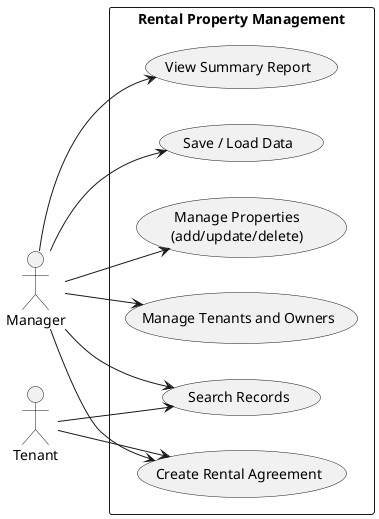
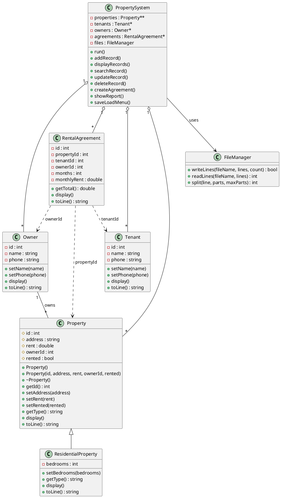
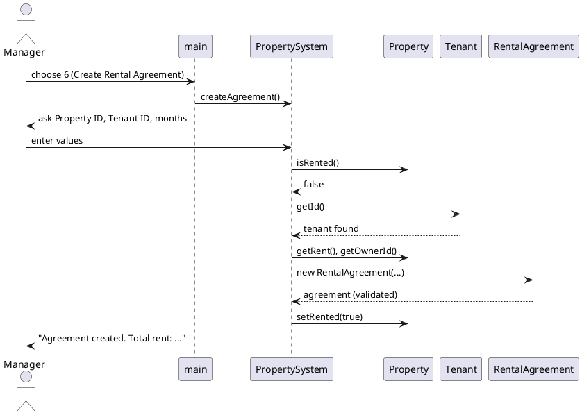
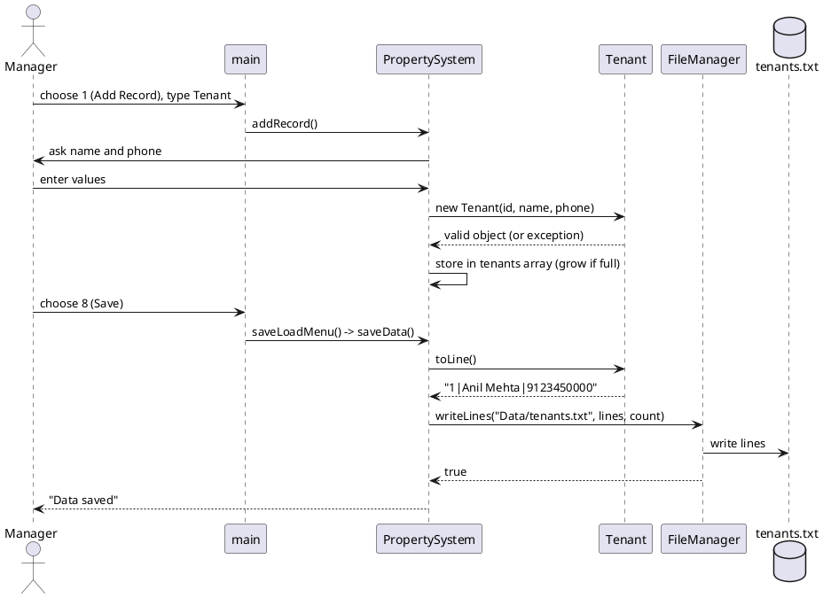

# Rental Property Management — Project Report

## 1. Project Title
Rental Property Management

## 2. Student Details
Enrollment Number: IU2541230534 | Project Code: CPP59

## 3. Problem Statement
Property owners often keep rental details in notebooks or loose papers. This makes it hard to find which flats are free, who the tenant is, and how much rent is due. This project is a console program that stores owners, properties, tenants and rental agreements, and keeps the data in text files so nothing is lost when the program is closed.

## 4. Objectives
- Store and manage owner, property, tenant and agreement records.
- Apply OOP concepts: classes, encapsulation, constructors/destructors, inheritance and runtime polymorphism.
- Use dynamic arrays (`new` / `delete[]`) with a simple resize function.
- Save and load data using text files.
- Validate input and handle errors with `try-catch`.
- Keep the code modular in separate `.h` / `.cpp` files.

## 5. Features
| Menu | Operation |
|---|---|
| 1 | Add Record (Property, Tenant or Owner) |
| 2 | Display Records (all four lists) |
| 3 | Search Record by ID |
| 4 | Update Record (address/rent, or name/phone) |
| 5 | Delete Record (blocked if still in use) |
| 6 | Main Transaction: Create Rental Agreement |
| 7 | Report: counts, total monthly rent, total agreement value |
| 8 | Save / Load Data |
| 9 | Exit (data is saved automatically) |

Data is loaded automatically when the program starts.

## 6. Classes and Responsibilities
| Class | Responsibility | Main data members | Important functions |
|---|---|---|---|
| `Property` | Base class for any rental property | id, address, rent, ownerId, rented | setters with validation, virtual `display()`, `getType()`, `toLine()` |
| `ResidentialProperty` | Derived class: house or flat | bedrooms | overrides `display()`, `getType()`, `toLine()` |
| `Tenant` | A person renting a property | id, name, phone | `setName()`, `setPhone()`, `display()`, `toLine()` |
| `Owner` | A person who owns properties | id, name, phone | `setName()`, `setPhone()`, `display()`, `toLine()` |
| `RentalAgreement` | Links one property, tenant and owner (by ID) | id, propertyId, tenantId, ownerId, months, monthlyRent | `getTotal()`, `display()`, `toLine()` |
| `FileManager` | Reads and writes text files | none | `writeLines()`, `readLines()`, `split()` |
| `PropertySystem` | Holds all dynamic arrays and runs menu actions | arrays, counts, capacities, next IDs | `run()`, `addRecord()`, `createAgreement()`, `showReport()`, `saveData()`, `loadData()` |

`main.cpp` only creates a `PropertySystem` object and calls `run()`.

## 7. OOP Concepts Used

**Classes and objects:** each real-world thing is a class, for example `Tenant t(1, "Anil", "9123450000");`.

**Constructors and destructor:** each class has a default and a parameterized constructor. `Property` has a virtual destructor:
```cpp
Property();
Property(int id, std::string address, double rent, int ownerId, bool rented = false);
virtual ~Property();
```

**Encapsulation:** data members are `private` or `protected`. They can only be changed through setters that check the value:
```cpp
void Property::setRent(double rent) {
    if (rent <= 0) throw invalid_argument("Rent must be greater than 0.");
    this->rent = rent;
}
```

**Inheritance:** `ResidentialProperty` reuses everything in `Property` and adds `bedrooms`:
```cpp
class ResidentialProperty : public Property { ... };
```

**Runtime polymorphism:** the array stores base-class pointers. The call `display()` runs the version of the real object (`ResidentialProperty`), because `display()` is `virtual`:
```cpp
for (int i = 0; i < propCount; i++) properties[i]->display();
```

**Dynamic memory:** arrays are created with `new` and grow when full. They are released in the destructor:
```cpp
properties = new Property*[propCap];
Tenant* bigger = new Tenant[newCap];        // when the array is full
delete[] tenants;                           // old array released
for (int i = 0; i < propCount; i++) delete properties[i];
delete[] properties;
```
Purpose: the number of records is not known in advance, so the program starts with space for 4 and doubles it when needed.

## 8. File Handling
Four text files are stored in the `Data/` folder, one record per line, fields separated by `|`:

| File | Example line |
|---|---|
| `owners.txt` | `1\|Ramesh Shah\|9876543210` |
| `tenants.txt` | `2\|Priya Nair\|9000000001` |
| `properties.txt` | `R\|1\|12 MG Road, Pune\|15000\|1\|1\|2` |
| `agreements.txt` | `1\|1\|2\|1\|12\|15000.000000` |

**Saving:** each object creates its line with `toLine()`. `FileManager::writeLines()` writes them with `std::ofstream`.
**Loading:** `FileManager::readLines()` reads lines with `std::ifstream`, `split()` cuts each line at `|`, and `PropertySystem::loadData()` rebuilds the objects. A bad line is skipped with a message.
**Persistence test:** records were added, the program was exited (auto-save), then started again. All records and the next ID numbers were restored.

## 9. UML Diagram Explanations
The PlantUML scripts are in the `Diagrams/` folder and in the appendix below.
- **Use Case Diagram:** two actors, Manager and Tenant. The Manager manages properties, tenants and owners, searches, creates agreements, views reports and saves/loads. The Tenant can search properties and take part in creating an agreement.
- **Class Diagram:** shows the seven classes with fields and methods. `ResidentialProperty` inherits from `Property`. `PropertySystem` holds many objects of each entity (aggregation) and uses `FileManager`. `RentalAgreement` refers to a property, tenant and owner by ID. One owner owns many properties.
- **Sequence Diagram 1 (Create Rental Agreement):** Manager chooses option 6, `PropertySystem` checks that the property is free and the tenant exists, creates the `RentalAgreement`, marks the property rented, and shows the total.
- **Sequence Diagram 2 (Add and Save a Record):** Manager adds a tenant (validated in the constructor), then saves. Each object gives its text line, and `FileManager` writes it to `tenants.txt`.

## 10. Program Workflow
1. Program starts; `main` creates `PropertySystem` and calls `run()`.
2. Existing records are loaded from `Data/`.
3. The menu is shown; the user enters a choice (1–9).
4. `PropertySystem` calls the matching function. It validates input and prints a message for any error.
5. Option 6 checks property and tenant, creates a `RentalAgreement` and marks the property as rented.
6. The loop repeats until the user chooses 9.
7. On exit all records are saved and the memory is released by the destructor.

## 11. Screenshots
*(Insert screenshots of: menu, add owner/property/tenant, display records, create agreement, report, and the program after restart showing loaded data.)*

## 12. Testing
| # | Test | Input | Expected | Actual |
|---|---|---|---|---|
| 1 | Add valid tenant | Name `Priya Nair`, phone `9000000001` | Tenant added with new ID | Tenant added with ID |
| 2 | Invalid phone | Name `Bad`, phone `123` | Error, nothing added | "Phone must have exactly 10 digits." |
| 3 | Invalid rent | Rent `-5` | Error, nothing added | "Rent must be greater than 0." |
| 4 | Create agreement | Property 1, Tenant 2, 12 months, rent 15000 | Agreement created, total 180000, property becomes Rented | "Agreement 1 created. Total rent: 180000" |
| 5 | Rent an already rented property | Property 1 again | Refused | "Property is already rented." |
| 6 | Delete a rented property | Property 1 | Refused | "Cannot delete: property is rented." |
| 7 | Array resize | Add 6 tenants (start capacity 4) | All 6 stored | All 6 displayed correctly |
| 8 | Persistence | Add data, exit, run again | Same data shown | Same data loaded |

## 13. Challenges and Solutions
| Challenge | Solution |
|---|---|
| Dynamic array becomes full | `growXxx()` functions allocate a new array of double size, copy the items, `delete[]` the old one |
| Memory leaks with `Property*` | Destructor deletes each object, then the array; tested with AddressSanitizer (no errors) |
| Wrong input (letters instead of numbers) | `readInt()` / `readDouble()` repeat the question until the input is valid |
| Bad data entering the system | Setters and constructors throw `invalid_argument`; `PropertySystem` catches it and prints the message |
| Half-updated records | Update first builds a temporary object to check the new values, then changes the real record |
| Deleting data that is still used | Delete is refused for a rented property, an owner with properties, or a tenant with an agreement |
| Reading a text file into a dynamic array | `readLines()` counts lines first, then allocates exactly the needed array |

## 14. Conclusion
The project meets the blueprint: a 9-option menu, modular classes, inheritance with runtime polymorphism, dynamic memory, validation with exceptions, and file persistence. I learned how to divide a program into classes, manage memory manually, and design simple text-file storage. Possible future improvements: a commercial property class, rent payment tracking, and ending an agreement to free the property.

---
## Appendix: PlantUML Scripts

### UseCase


### ClassDiagram


### Sequence1_CreateAgreement


### Sequence2_AddAndSave

